# Traceability Matrix & E2E Acceptance Test Suite — PBI-036

Bản đối chiếu chi tiết giữa **SRS v2.0**, **Product Backlog Items (PBI)** và **Acceptance Criteria (AC)** kèm test cases kiểm chứng tự động toàn diện từ đầu đến cuối (End-to-End).

---

## 1. Traceability Matrix: SRS v2.0 -> PBI -> Acceptance Criteria

| FR / SRS v2.0 | Epic / PBI | Acceptance Criteria (Given - When - Then) | Test Case Kiểm Chứng | Trạng Thái |
| :--- | :--- | :--- | :--- | :---: |
| **FR-AUTH-01** GitHub OAuth & Session | **PBI-005** | Given chưa đăng nhập; When truy cập API bảo vệ; Then trả về 401 Unauthorized | `test_unauthenticated_requests_return_401` | **PASS** |
| **FR-PRIV-01** Dual Consent & Scope | **PBI-007** **PBI-008** | Given private repo; When thiếu consent; Then trả 403 Forbidden; When revoke consent; Then dọn dẹp sạch artifacts và chặn phân tích | `test_private_repo_without_consent_returns_403` `test_revoked_consent_fails_closed_immediately` `test_cleanup_on_revoke` | **PASS** |
| **FR-ANALYSIS-01** Repository Code Analysis | **PBI-012** **PBI-013** | Given repo đã cấp quyền; When chạy phân tích tĩnh; Then trích xuất bằng chứng (AST/manifest/structure) và xác minh quyền đóng góp (ownership) | `test_verified_contribution_flow` `test_unverified_contribution_rejected` | **PASS** |
| **FR-SCORE-01** Multi-Role Scoring Engine | **PBI-016** **PBI-017** | Given skills & architecture evidence; When tính điểm role; Then áp dụng rubric chuẩn, điểm không bị lạm phát (anti-inflation) | `test_role_scoring_engine_full_flow` `test_anti_inflation_rules` | **PASS** |
| **FR-SCOPE-01** Confidence & 3 Scopes | **PBI-018** | Given public & private repos; When tính scoped score; Then tách riêng Public/Private/Combined và Combined tự động khử trùng lặp | `test_scoped_scoring_public_private_combined` `test_combined_dedup_no_inflation` | **PASS** |
| **FR-MENTOR-01** AI Mentor Policy & Chat | **PBI-021** **PBI-022** | Given hội thoại mentor; When yêu cầu tác vụ nhạy cảm; Then qua Policy Gateway và kiểm soát quota/audit log | `test_policy_gateway_and_mentor_chat` | **PASS** |
| **FR-ROADMAP-01** Personalized Roadmap | **PBI-023** | Given role mục tiêu & khoảng cách kỹ năng; When tạo roadmap; Then gợi ý lộ trình học tập cá nhân hoá | `test_career_roadmap_generation` | **PASS** |
| **FR-JOB-01** JD Analysis & Safe Fetch | **PBI-025** | Given text hoặc URL JD; When phân tích; Then phân loại Required vs Preferred skills; chặn SSRF an toàn | `test_jd_analysis_text_and_url_safe` | **PASS** |
| **FR-RESUME-01** AI Resume & Anti-Copy | **PBI-032** | Given reference template & verified facts; When tạo CV; Then sinh CV gốc, hiển thị disclaimer, chặn sao chép (>20%) | `test_resume_pattern_and_anti_copy` | **PASS** |
| **FR-SEC-01** Privacy & Negative-Path | **PBI-035** | Given kịch bản tấn công (SSRF, data leak, cross-user); When gọi API; Then chặn đứng và không rò rỉ secret | `test_negative_path_security_matrix` | **PASS** |

---

## 2. E2E Pipeline Workflow Kiểm Thử Thực Tế

```mermaid
flowchart LR
    A["1. GitHub & Consent (PBI-005/007)"] --> B["2. Static Analysis & Verification (PBI-012/013)"]
    B --> C["3. Role Scoring & Scopes (PBI-017/018)"]
    C --> D["4. AI Mentor & Policy Gateway (PBI-021/022)"]
    D --> E["5. Career Roadmap (PBI-023)"]
    E --> F["6. JD Analysis & SSRF Guard (PBI-025)"]
    F --> G["7. AI Resume Generation (PBI-032)"]
    G --> H["8. Security Audit & DoD Verification (PBI-035/036)"]
```

