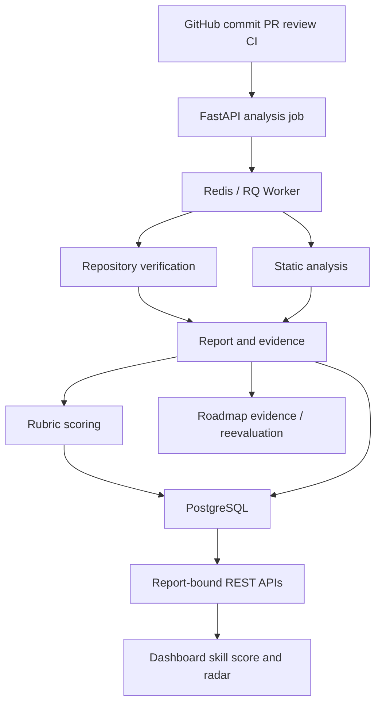

# Kịch bản nghiệm thu E2E: GitHub → Verification → Scoring → Dashboard

**Trạng thái:** kế hoạch kiểm thử, chưa thực thi trên môi trường thật. Không phải báo cáo PASS.
**Phạm vi:** PBI-011/012/013/015/016, Dashboard và tích hợp Roadmap Evidence.
**Môi trường:** localhost Docker Compose, hai tài khoản GitHub QA, dữ liệu thử nghiệm riêng.

## 1. Mục tiêu và nguyên tắc

- Đối chiếu dữ liệu độc lập từ GitHub với job, report, verification, scoring, API và UI.
- Phân biệt phát hiện công nghệ (static analysis), đóng góp cá nhân được xác minh và mức độ bao phủ minh chứng của Radar. Không đồng nhất Skill Score, Radar và Role Score.
- Không đánh giá năng lực từ code kế thừa, bot, tác giả khác hoặc merge commit không đủ điều kiện.
- Không dùng dữ liệu chèn trực tiếp vào DB làm bằng chứng E2E thực. Các fixture nhân tạo chỉ phục vụ kiểm thử tầng engine/integration.
- Thiếu minh chứng là Insufficient/null, không phải điểm 0.
- GitHub authorship không chứng minh người dùng tự viết hoặc hiểu toàn bộ code.
- Chỉ ghi nhận PASS khi có kết quả thực tế và bằng chứng; nếu chưa chạy ghi NOT RUN, nếu không thể chạy ghi BLOCKED.

## 2. Luồng và điểm kiểm soát



| Điểm kiểm soát | Đầu vào đối chứng | Đầu ra cần lưu |
| --- | --- | --- |
| GitHub | branch, SHA, actor ID/login, PR, changed files, review/check | URL và dữ liệu GitHub gốc |
| Job | user, repository, scope, range, branch | job_id, events, report_id, status |
| Static analysis | source tại SHA snapshot | report, languages/frameworks, evidence |
| Verification | GitHub event và quyền truy cập | verification status, coverage, limitations, evidence IDs |
| Scoring | verified events, source findings, rubric version | status, score, breakdown, diagnostics |
| Dashboard | report_id, scope/range, API JSON | ảnh UI, request/response, giá trị hiển thị |
| Roadmap | URL commit/PR, skill, milestone | trạng thái xác minh, lịch sử, reevaluation |

Source tham chiếu: [analysis router](../../backend/app/modules/analysis/router.py), [analysis models](../../backend/app/modules/analysis/models.py), [scoring engine](../../backend/app/modules/scoring/engine.py), [scoring router](../../backend/app/modules/scoring/router.py), [scoring models](../../backend/app/modules/scoring/models.py), [dashboard radar](../../backend/app/modules/analysis/dashboard_radar.py), [frontend orchestration](../../frontend/src/pixel-studio/live.js), [score presentation](../../frontend/src/pixel-studio/score-presentation.js).

## 3. Dữ liệu đối chứng

Tạo repo QA riêng, không thay đổi lịch sử repo sản phẩm. A là user đang được đánh giá; B là cộng tác viên. Dùng tài khoản thật của nhóm hoặc tài khoản QA đã được phép, cấu hình email commit được GitHub liên kết đúng actor. Không chia sẻ token, cookie hoặc dữ liệu private.

| Repo | Dữ liệu |
| --- | --- |
| qa-e2e-full-evidence | 8 non-merge commits, 2 PR đã merge, review của A và B, CI hoàn tất |
| qa-e2e-few-commits | 1 commit Python/FastAPI của A, không PR |
| qa-e2e-empty | Repo rỗng, chưa có commit |
| qa-e2e-no-tests | Source có đóng góp A, không test, không cấu hình test |
| qa-e2e-manifest-only | requirements.txt khai báo FastAPI, không có source sử dụng FastAPI |
| qa-e2e-fork | Fork không chỉnh sửa, sau đó thêm đóng góp riêng của A |
| qa-e2e-multi-author | A và B sửa các file khác nhau, có thể thêm bot/merge làm đối chứng |
| qa-e2e-private | Repo private QA, thử trước/sau consent, thử user không được cấp quyền |

### Repo đầy đủ: trình tự tạo dữ liệu

Tạo branch mặc định main, dùng merge commit cho PR để giữ các commit gốc; tránh squash nếu mục tiêu là đếm 8 non-merge commits.

| Ký hiệu | Actor | Thay đổi | Branch |
| --- | --- | --- | --- |
| C01 | A | app/main.py, requirements.txt (FastAPI) | main |
| C02 | A | GET endpoint trong app/main.py | feature/api |
| C03 | A | app/models.py, app/services.py; tích hợp dữ liệu nếu muốn kiểm tra data_design | feature/api |
| C04 | A | POST endpoint và validate input | feature/api |
| C05 | A | tests/test_api.py | feature/api |
| C06 | A | .github/workflows/ci.yml chạy pytest | feature/api |
| C07 | B | app/services.py: logic mới do B viết | feature/service |
| C08 | A | sửa lỗi theo review của B | feature/api |

1. Tạo C01 trên main. Tạo feature/api, thực hiện C02–C06; A mở PR-1, B review, A bổ sung C08; CI chạy lại. Merge PR-1 vào main.
2. B tạo feature/service từ main mới, thực hiện C07 và mở PR-2. A review PR-2, CI chạy, merge vào main.
3. Ghi nhận SHA của 8 commit gốc và các merge commit riêng. Ghi nhận PR number, author, review actor, check state/conclusion, changed files và timestamp UTC. Số commit hiển thị toàn repo có thể lớn hơn 8 vì merge commits; không dùng số toàn repo làm số eligible của A.
4. Tuỳ chọn thêm pytest.ini hoặc conftest.py trong một commit riêng để kiểm tra testing tăng từ 1/2 lên 2/2; lưu đây là snapshot B, không sửa ground truth của snapshot A.
5. Cố định range (bao gồm toàn bộ các sự kiện mẫu), branch, scope và snapshot SHA. Không push trong lần chạy baseline. Khi thử thay đổi/race, ghi SHA mới rõ ràng.

Mẫu ghi ground truth (thay mọi giá trị minh họa bằng giá trị thật):

| Repo | Actor | Event type | SHA/PR | UTC timestamp | Changed files | GitHub URL | Eligible? lý do |
| --- | --- | --- | --- | --- | --- | --- | --- |
| qa-e2e-full-evidence | A | commit | C02 → SHA thật | ... | app/main.py | ... | Có, nếu verification xác nhận |
| qa-e2e-full-evidence | B | commit | C07 → SHA thật | ... | app/services.py | ... | Không thuộc A |

Không suy luận eligible chỉ từ số commit; so sánh theo quy tắc verification, scope, time range và coverage thực tế.

## 4. Runbook trên Windows PowerShell

Chạy tại root repo. Dùng môi trường QA hoặc bản sao DB, không dùng dữ liệu thật cho fault injection.

```powershell
git rev-parse HEAD
docker compose ps
docker compose exec redis redis-cli ping
Invoke-RestMethod http://localhost:5173/api/v1/health
docker compose exec backend alembic current
docker compose exec backend alembic heads
```

Kiểm tra health, worker running và migration current khớp head. Mở http://localhost:5173 và đăng nhập GitHub A. Swagger: http://localhost:8000/api/v1/docs (dev; kiểm tra cấu hình nếu khác).

### 4.1. Analysis job

Đồng bộ GitHub và chọn repo QA qua giao diện. Ưu tiên chạy từ UI; mở F12 → Network, bật Preserve log để lưu request/response. API dùng phiên đăng nhập, POST cần Origin hợp lệ theo cấu hình frontend.

```http
POST /api/v1/analysis/jobs
Content-Type: application/json
```

```json
{"repository_id": 1, "scope": "full", "branch": "main"}
```

ID 1 chỉ là ví dụ. Ghi range/filter thực tế từ UI; chọn cùng range khi đối chiếu. Response dự kiến HTTP 202; ghi job_id thực.

```http
GET /api/v1/analysis/jobs/{job_id}
GET /api/v1/analysis/jobs/{job_id}/events
```

```powershell
docker compose logs --tail=100 worker
```

PASS positive flow: job succeeded, progress hoàn tất, report_id hợp lệ, không có lỗi chưa xử lý. Job failed/cancelled không được báo thành công trên UI. Với repo rỗng hoặc lỗi upstream có thể trả trạng thái lỗi có giải thích; không bắt buộc succeeded.

### 4.2. Report và scoring

```http
GET /api/v1/repositories/{repo_id}/analysis?report_id={report_id}
GET /api/v1/repositories/{repo_id}/analysis/evidence?report_id={report_id}
GET /api/v1/scoring/repositories/{repo_id}/skills?report_id={report_id}
```

So sánh SHA snapshot với GitHub branch đã cố định, languages/frameworks với file thực, evidence count, coverage, budget, diagnostics. SHA report không nhất thiết là SHA của từng commit đóng góp.
Đối chiếu evidence_id theo evidence_kind tương ứng; static finding ID không đồng nhất với verification event ID. Đối chiếu actor, repo, report và changed_files. Kiểm tra phân trang nếu số skill vượt limit mặc định.

### 4.3. Dashboard

```http
GET /api/v1/repositories/{repo_id}/analysis/dashboard-report
GET /api/v1/repositories/{repo_id}/analysis/dashboard-radar?report_id={report_id}
GET /api/v1/scoring/repositories/{repo_id}/skills?report_id={report_id}
```

Dùng chính query filter mà frontend gửi (scope/range theo endpoint). Dashboard-report chọn report theo cửa sổ thời gian; không tự thay report_id bằng latest toàn DB. Kiểm tra request scoring/radar cùng report_id.
Khi UI tổng hợp nhiều repo, kiểm thử repo QA cô lập trước, sau đó đối chiếu quy tắc tổng hợp UI; không so điểm tổng hợp với score của một repo. Lưu ảnh Dashboard, API JSON và giá trị độc lập. Nếu API lỗi riêng lẻ, kiểm tra trạng thái partial thay vì số 0 mặc định.

## 5. Oracle tính điểm

### Language rubric mặc định

Theo scoring/engine.py, version mặc định 1.0.0: code_contribution 30, commit_frequency 20, pr_contribution 20, complexity 20, confidence 10. Với metric chuẩn hóa trong [0,1], điểm là tổng metric × weight; engine làm tròn từng điểm thành phần 4 chữ số và tổng 2 chữ số. Khi đối soát report thực, sử dụng rubric version/criteria đã lưu, không mặc định mọi snapshot có cùng weights.

| Metric (giả định) | Value | Weight | Points |
| --- | ---: | ---: | ---: |
| code_contribution | 0.80 | 30 | 24 |
| commit_frequency | 0.50 | 20 | 10 |
| pr_contribution | 0.75 | 20 | 15 |
| complexity | 0.60 | 20 | 12 |
| confidence | 0.90 | 10 | 9 |
| Tổng | | 100 | 70 |

Không khẳng định fixture GitHub ở mục 3 phải đạt 70. Tính lại từ dữ liệu breakdown thực và kiểm tra cả cách chuẩn hóa, không chỉ cộng điểm. Metric thiếu hoặc không có evidence IDs → Insufficient/null. Metric quan sát bằng 0 có evidence hợp lệ không đồng nghĩa missing.

### Framework rubric

Code mặc định: code_contribution 40, complexity 20, verified_activity 30, confidence 10. PR hợp lệ hoặc non-merge commit hợp lệ có thể chứng minh activity; vẫn phải có đóng góp trên source sử dụng framework và đủ các tiêu chí. Manifest-only không chứng minh proficiency.

### Radar rubric github-evidence-coverage-v1

| Axis | Criteria | Expected nếu quan sát đúng các tiêu chí ví dụ |
| --- | --- | --- |
| code | source_change, framework_source | 2/2 = 100 |
| architecture | service_design, data_design, structure_design | 2/3 = 67 |
| testing | test_change, test_config | 1/2 = 50 |
| collaboration | authored_pr, merged_pr, peer_review | 3/3 = 100 |
| ci | workflow_change, completed_check | 2/2 = 100 |

Công thức mỗi trục: round(100 × số criteria quan sát / tổng criteria); không quan sát tiêu chí nào → null. Các con số là ví dụ có điều kiện, không phải điểm đã chạy. Kiểm tra evidence theo criterion; completed_check bao gồm cả một số kết quả failure/timed_out theo code, không đồng nghĩa CI pass. Testing rubric nhận diện thay đổi file test/config, không đo code coverage hoặc chất lượng test. Không gọi Radar 100% là thành thạo tuyệt đối.

### Rủi ro cần xác nhận

Engine trả float nhưng SkillScore.score là Integer; xác minh quy tắc chuyển đổi/làm tròn khi lưu và hiển thị. Không tự đặt quy tắc làm tròn thay code.
Frontend reportBackedSkillScore kiểm tra status/điểm hợp lệ và evidence_kind=verification với ID dương; backend phải xác minh provenance thật. Không chỉ kiểm tra ID có tồn tại mà còn đúng user/repo/report và đủ điều kiện.

## 6. SQL đối chứng chỉ đọc

Thay các ID ví dụ 1/14 bằng user, repo, report thật. Mỗi block SQL chạy trong psql (Docker) hoặc lưu vào file tạm rồi pipe PowerShell:
```powershell
Get-Content .\qa-check.sql -Raw | docker compose exec -T postgres psql -v ON_ERROR_STOP=1 -U ita -d it_ai_profile
```

Các truy vấn chỉ SELECT, không reset DB, không tạo score giả. Có thể dùng BEGIN READ ONLY / COMMIT để bảo vệ phiên kiểm tra.

```sql
-- 1. Job và report: cùng repo, cùng user, đúng ID
SELECT j.id AS job_id, j.user_id, j.repo_id, j.status, j.progress,
       j.report_id, r.commit_sha, r.analyzed_at, r.time_range, r.budget
FROM ita.analysis_jobs j
LEFT JOIN ita.analysis_reports r ON r.id = j.report_id
WHERE j.repo_id = 1 AND j.user_id = 1 AND j.report_id = 14;

-- 2. Coverage và verification
SELECT id, report_id, user_id, verification_status, coverage_status,
       confidence, verified_commits_count, verified_prs_count,
       limitations, summary_data
FROM ita.repository_verifications
WHERE report_id = 14 AND repository_id = 1 AND user_id = 1;

-- 3. Event provenance và changed files
SELECT ve.id, ve.verification_id, ve.evidence_type, ve.target_identifier,
       ve.actor_login, ve.actor_id, ve.verification_status, ve.is_merge,
       ve.is_bot, ve.is_fork_inherited, ve.recorded_at,
       ve.metadata->'changed_files' AS changed_files, ve.html_url
FROM ita.verification_evidence ve
JOIN ita.repository_verifications rv ON rv.id = ve.verification_id
WHERE rv.report_id = 14 AND rv.repository_id = 1 AND rv.user_id = 1
  AND ve.repository_id = rv.repository_id AND ve.user_id = rv.user_id
ORDER BY ve.id;

-- 4. Static findings
SELECT id, finding_type, classification, evidence_source,
       file_path, commit_sha, confidence
FROM ita.analysis_evidence
WHERE report_id = 14 AND repository_id = 1
ORDER BY id;

-- 5. Scoring snapshot và rubric
SELECT s.id, s.report_id, s.technology, s.kind, s.status, s.score,
       r.version, r.criteria, s.commit_sha, s.breakdown
FROM ita.skill_scores s
JOIN ita.rubric_versions r ON r.id = s.rubric_id
WHERE s.report_id = 14 AND s.repository_id = 1 AND s.user_id = 1
ORDER BY s.kind, s.technology, s.created_at DESC, s.id DESC;

-- 6. Điểm sai miền hoặc sai status: kỳ vọng 0 hàng
SELECT id, technology, status, score
FROM ita.skill_scores
WHERE report_id = 14 AND repository_id = 1 AND user_id = 1
  AND ((status = 'Scored' AND (score IS NULL OR score NOT BETWEEN 0 AND 100))
    OR (status = 'Insufficient' AND score IS NOT NULL));

-- 7. Evidence link sai snapshot: kỳ vọng 0 hàng
SELECT s.id AS score_id, e.id AS evidence_id, s.report_id, e.report_id
FROM ita.skill_scores s
JOIN ita.score_evidence_links l ON l.score_id = s.id
JOIN ita.analysis_evidence e ON e.id = l.evidence_id
WHERE s.report_id = 14 AND s.repository_id = 1 AND s.user_id = 1
  AND (e.report_id <> s.report_id OR e.repository_id <> s.repository_id
       OR e.commit_sha <> s.commit_sha);
```

Truy vấn 7 chỉ kiểm tra link static analysis; breakdown verification IDs phải đối chiếu với truy vấn 3 riêng. Nếu report có nhiều verification rows, chọn row thực dùng cho snapshot/API, không cộng dồn các lần phân tích.

## 7. Test matrix

P0 = tính đúng, bảo mật, sai kết quả nghiêm trọng; P1 = xử lý biên/UX đáng kể. Mặc định mọi test NOT RUN. E2E = GitHub thật qua UI/API; INT = môi trường QA với fault injection hoặc dữ liệu kiểm soát; UNIT = engine/regression. Không gọi UNIT là E2E.

| ID | Tầng | Priority | Thao tác / dữ liệu | Expected |
| --- | --- | --- | --- | --- |
| E2E-01 | E2E | P0 | Repo đầy đủ; thực hiện mục 4–6 | Trace GitHub → job → report → verified evidence → score → UI |
| E2E-02 | E2E | P0 | Phân tích repo rỗng | Empty state/lỗi có giải thích; không tạo điểm giả |
| E2E-03 | E2E | P1 | Repo 1 commit không PR | Chỉ score nếu đủ tiêu chí; kiểm tra missing metrics |
| E2E-04 | E2E | P0 | Repo có merge commits của A | Không tính merge-only như đóng góp trực tiếp |
| E2E-05 | E2E | P0 | Bot commit/PR trong repo QA | Không tính vào evidence cá nhân A |
| E2E-06 | E2E | P0 | Fork chưa sửa | Không nhận inherited code là đóng góp A |
| E2E-07 | E2E | P0 | Fork có commit mới của A | Chỉ đánh giá đóng góp đủ điều kiện |
| E2E-08 | E2E | P0 | A/B sửa file khác nhau | Score/evidence A không chứa công lao của B |
| E2E-09 | E2E | P0 | Private repo trước consent; user không quyền; sau consent | Từ chối phù hợp trước cấp quyền; không lộ dữ liệu |
| E2E-10 | INT | P1 | Giả lập GitHub 429/rate limit, không spam API thật | Coverage/limitations hoặc lỗi rõ; không chế dữ liệu |
| E2E-11 | E2E | P0 | Manifest-only FastAPI | Nhận diện dependency nếu hỗ trợ; không có proficiency giả |
| E2E-12 | E2E | P0 | B viết source framework, A không sửa | Không score từ source của B |
| E2E-13 | E2E | P0 | A có non-merge commit FastAPI, không PR | Có thể score framework nếu đủ các tiêu chí |
| E2E-14 | INT/E2E | P0 | PR có file framework hợp lệ, không có commit đủ điều kiện | Không bắt buộc cả hai loại activity |
| E2E-15 | UNIT/INT | P0 | Thiếu criterion hoặc evidence IDs | Insufficient/null |
| E2E-16 | UNIT/INT | P1 | Tất cả metrics = 0 có evidence IDs hợp lệ ở fixture | Engine Scored 0; UI không nhầm missing |
| E2E-17 | UNIT/INT | P1 | Tất cả metrics = 1 có evidence | Engine Scored 100 |
| E2E-18 | UNIT | P0 | Metric <0, >1, NaN, infinity; evidence đầy đủ | ValueError |
| E2E-19 | UNIT | P1 | Evidence IDs lặp trong metric | Breakdown dedup IDs |
| E2E-20 | E2E | P0 | Chạy lại snapshot, actor, range, rubric và input không đổi | Điểm nhất quán; không giả định report ID phải giống |
| E2E-21 | INT | P1 | Metric tạo điểm lẻ | Xác minh chính sách lưu Integer, API và UI nhất quán |
| E2E-22 | E2E | P0 | Không test/config; sau đó thêm test | Trục testing null rồi có evidence tương ứng |
| E2E-23 | E2E | P0 | Không workflow/check | Không có CI evidence giả |
| E2E-24 | INT | P0 | Có report nhưng chưa có scoring snapshot | API missing snapshot/Insufficient, không score mặc định |
| E2E-25 | E2E | P0 | Tạo report A, push commit, tạo report B | Scoring/radar đúng report được chọn |
| E2E-26 | E2E | P1 | Job đang queued/running | UI không báo hoàn thành sớm |
| E2E-27 | INT | P0 | Dừng worker trong Compose QA riêng, khởi động lại sau test | Không báo thành công sai; phục hồi hoặc lỗi có giải thích |
| E2E-28 | INT/E2E | P0 | Throttle network, đổi nhanh date/scope | Response cũ không ghi đè lựa chọn mới |
| E2E-29 | E2E | P0 | Đổi public/private scope | Chỉ tính repo đủ quyền và thuộc scope |
| E2E-30 | E2E | P1 | Reload với cùng filter và snapshot | Kết quả nhất quán |
| E2E-31 | INT | P1 | Block scoring request trong DevTools, radar vẫn thành công | Dữ liệu radar còn khả dụng, partial/error rõ |
| E2E-32 | INT/E2E | P0 | API score null | Không hiển thị 0 giả |
| E2E-33 | INT | P1 | Fixture Scored 0 có verified evidence | UI phân biệt 0 và null |
| E2E-34 | E2E | P0 | So DB, API, UI, quy tắc tổng hợp | Không lệch giá trị ngoài quy tắc làm tròn/aggregation |
| E2E-35 | E2E | P1 | Event ngoài range và tại biên UTC/timezone | Không tính ngoài range; biên theo hợp đồng API |
| E2E-36 | E2E | P0 | Nộp PR đúng skill/milestone | Xác minh nếu đủ điều kiện |
| E2E-37 | E2E | P0 | Commit không liên quan skill | Không xác minh nhầm |
| E2E-38 | E2E | P1 | Nộp cùng URL nhiều lần | Không tăng tiến độ giả |
| E2E-39 | E2E | P0 | Nộp PR/commit của B | Không nhận là đóng góp A |
| E2E-40 | E2E | P1 | Nộp link issue hoặc repo | Validation từ chối |
| E2E-41 | E2E | P0 | Minh chứng đã nộp, chưa xác minh | Phân biệt hoàn thành và verified |
| E2E-42 | E2E | P0 | Đánh giá lại từ snapshot mới | Đúng snapshot, không reset milestone tùy tiện |

Ưu tiên demo: 01, 04, 08, 11, 12, 13, 15, 22, 25, 28, 32, 34, 37, 42. Các P0 còn lại vẫn phải được nghiệm thu trước khi tuyên bố toàn bộ bộ test đạt.

## 8. Checklist và biên bản

- [ ] Ghi app commit SHA, môi trường, user QA, repo IDs, scope, time range và timezone.
- [ ] Ghi ground truth độc lập (SHA/PR URL, actor, files, review, CI).
- [ ] Docker/Redis/Worker/Alembic/health ổn định.
- [ ] Job events và report ID đúng; không báo thành công sai.
- [ ] Verification loại đúng bot/merge/inherited/other-author; coverage và limitations rõ.
- [ ] Static detection không bị nhầm thành proficiency.
- [ ] Score breakdown có evidence đúng loại và rubric; tính lại độc lập.
- [ ] DB/API/UI khớp snapshot, score, trạng thái và quy tắc tổng hợp.
- [ ] Radar criteria đúng evidence; null không bị đổi thành 0.
- [ ] Chạy kiểm tra race/partial failure và quyền truy cập.
- [ ] Roadmap không xác minh sai skill hoặc nhân đôi tiến độ.
- [ ] Lưu ảnh UI, JSON API (đã ẩn cookie/token), SQL output, job log đã redaction.
- [ ] Ghi PASS/FAIL/BLOCKED/NOT RUN từng case; liên kết issue cho lỗi.
- [ ] Không có lỗi P0 chưa xử lý và 100% P0 thực sự PASS để nghiệm thu toàn bộ.

Mẫu biên bản (không phải dữ liệu thực):

| Test ID | App SHA / repo SHA | User / report ID | Expected | Actual | Status | Evidence link / issue |
| --- | --- | --- | --- | --- | --- | --- |
| E2E-01 | ... | ... | Trace đầy đủ | Chưa chạy | NOT RUN | ... |
| E2E-34 | ... | ... | DB/API/UI nhất quán | Chưa chạy | NOT RUN | ... |

Lưu minh chứng vào nơi QA được phép truy cập. Không commit HAR chưa redaction, token, cookie, dữ liệu private hoặc dump DB lên repo public.

## 9. Giới hạn và tiêu chuẩn nghiệm thu

Tài liệu này là kế hoạch, dữ liệu mẫu, oracle và runbook đối chứng. Không tạo repo QA, không thay đổi runtime, không thực thi test hay khẳng định hệ thống PASS. Giá trị kỳ vọng về số điểm chỉ dùng với metric fixture hoặc khi criteria được quan sát đúng; cần kiểm tra trên dữ liệu thật trước bảo vệ. Fault injection chỉ chạy ở môi trường QA riêng, có kế hoạch phục hồi. Nếu phát hiện lỗi trong lúc chạy, tạo issue/PR sửa riêng, không che lỗi bằng thay đổi fixture hoặc số điểm.
